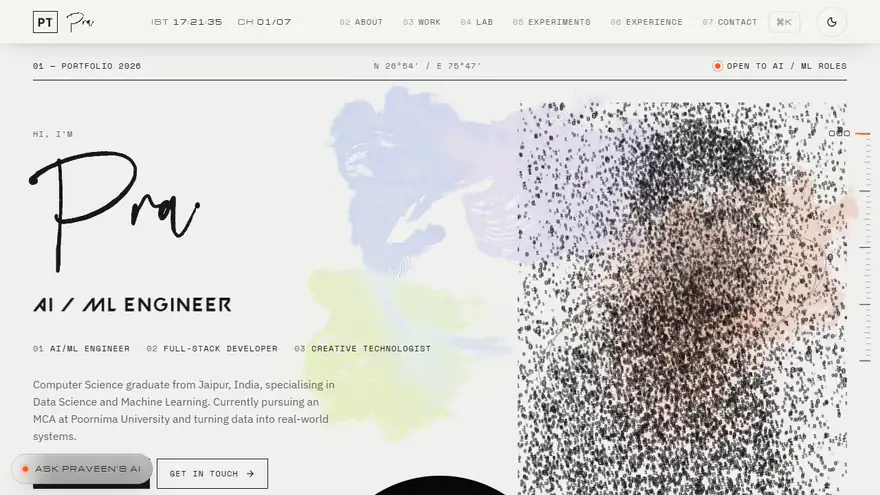
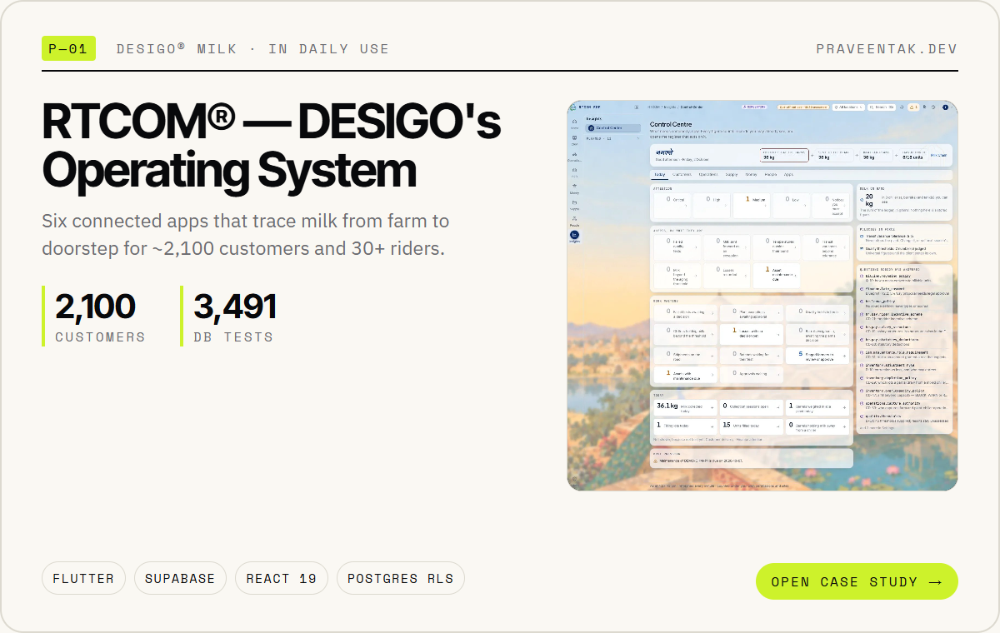
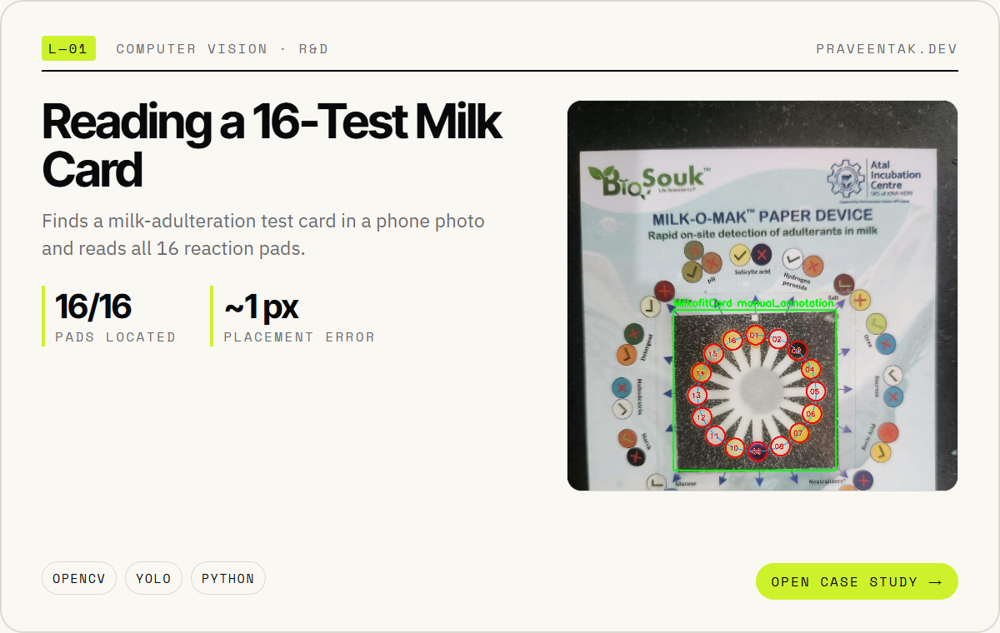
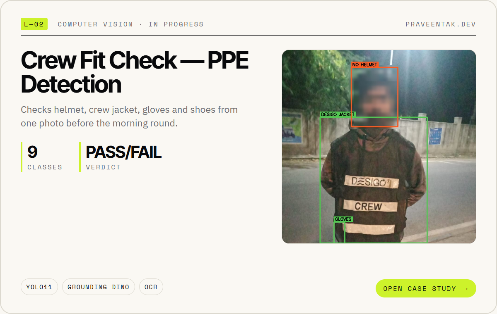
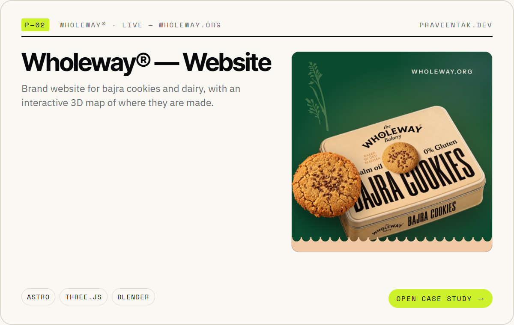
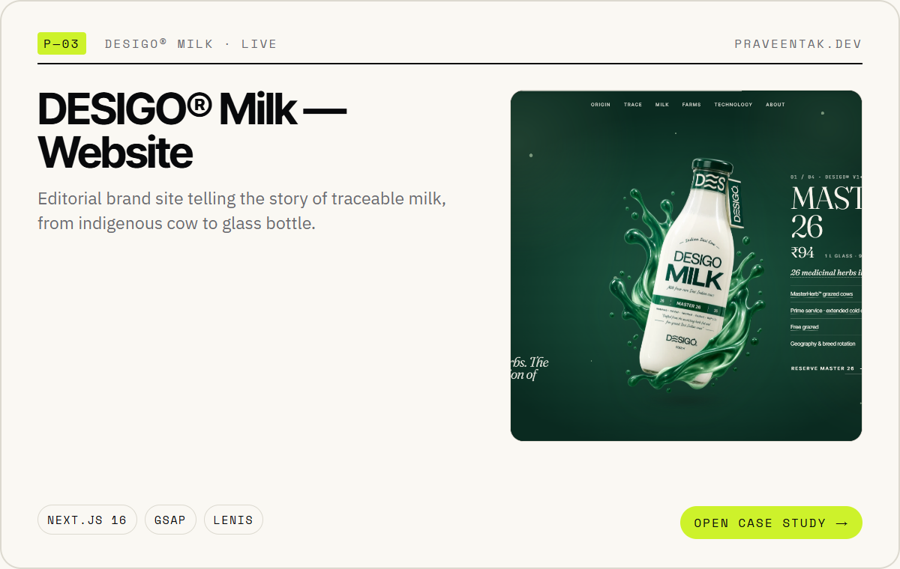
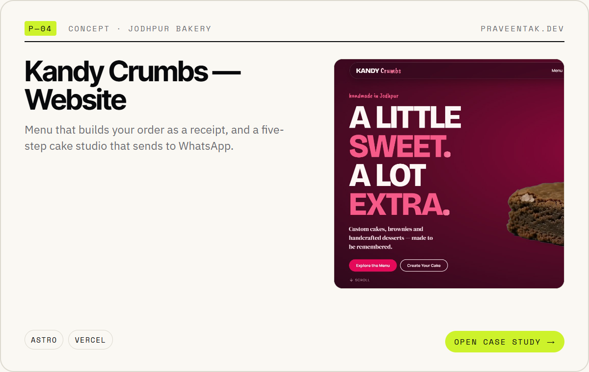
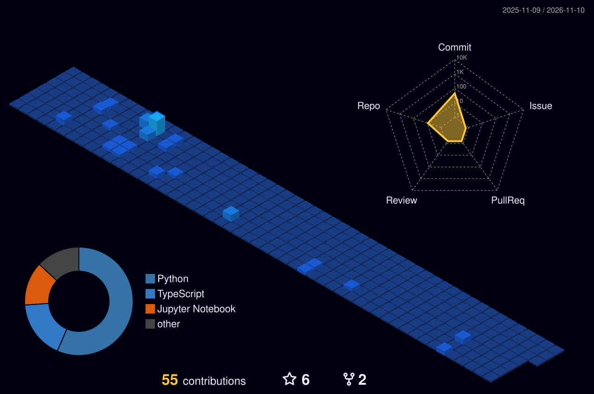

<!-- Profile README — palette: Soft Ivory #FAF8F3 · Midnight Black #08090B · Neon Lime #CDF22B (assets/ + tools/ regenerate everything). -->

<a href="https://praveentak.dev">
  <picture>
    <source media="(prefers-color-scheme: dark)" srcset="assets/header-dark.svg">
    
  </picture>
</a>

  <a href="https://praveentak.dev/about"><b>02 About</b></a>&nbsp;&nbsp;·&nbsp;&nbsp;
  <a href="https://praveentak.dev/work"><b>03 Work</b></a>&nbsp;&nbsp;·&nbsp;&nbsp;
  <a href="https://praveentak.dev/lab"><b>04 Lab</b></a>&nbsp;&nbsp;·&nbsp;&nbsp;
  <a href="https://praveentak.dev/experience"><b>06 Experience</b></a>&nbsp;&nbsp;·&nbsp;&nbsp;
  <a href="https://praveentak.dev/contact"><b>07 Contact</b></a>

 

↑ a 20-second scroll through <a href="https://praveentak.dev"><b>praveentak.dev</b></a> — open it for the real thing (ink, cursor and scroll effects).

 

### `01.1 — Now`

**AI Engineer at DESIGO® Milk**, Jodhpur — building **RTCOM**, the operating system behind traceable milk: Plant, Farm and Fleet apps, a customer app, face-recognition attendance and a Supabase ERP, serving **~2,100 customers** with **30+ riders**. On the side: computer vision R&D and websites that feel alive.

 

### `02 — Selected work`

  <a href="https://praveentak.dev/work/desigo-platform"><picture><source media="(prefers-color-scheme: dark)" srcset="assets/card-rtcom-dark.png"></picture></a>
  <a href="https://praveentak.dev/lab/milkofit-16-test-reader"><picture><source media="(prefers-color-scheme: dark)" srcset="assets/card-milkofit-dark.png"></picture></a>

  <a href="https://praveentak.dev/lab/crew-fit-check"><picture><source media="(prefers-color-scheme: dark)" srcset="assets/card-crew-dark.png"></picture></a>
  <a href="https://praveentak.dev/work/wholeway"><picture><source media="(prefers-color-scheme: dark)" srcset="assets/card-wholeway-dark.png"></picture></a>

  <a href="https://praveentak.dev/work/desigo-website"><picture><source media="(prefers-color-scheme: dark)" srcset="assets/card-desigo-site-dark.png"></picture></a>
  <a href="https://praveentak.dev/work/kandy-crumbs"><picture><source media="(prefers-color-scheme: dark)" srcset="assets/card-kandy-dark.png"></picture></a>

Every card opens its case study on praveentak.dev · more in <a href="https://praveentak.dev/work"><b>Work</b></a> and <a href="https://praveentak.dev/lab"><b>Lab</b></a>

 

### `03 — Toolkit`

  

 

### `04 — Activity`

  

 

### `07 — Contact`

  <a href="mailto:hello@praveentak.dev"><b>hello@praveentak.dev</b></a>&nbsp;&nbsp;·&nbsp;&nbsp;
  <a href="https://praveentak.dev"><b>praveentak.dev</b></a>&nbsp;&nbsp;·&nbsp;&nbsp;
  <a href="https://www.linkedin.com/in/praveentak/"><b>LinkedIn</b></a>&nbsp;&nbsp;·&nbsp;&nbsp;
  <a href="https://huggingface.co/PraveenTak"><b>Hugging Face</b></a>

Let's build something <b>rare.</b>

